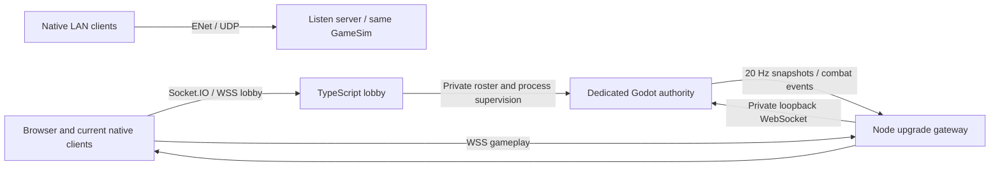

# Runtime and authority

The same `GameSim.tick` runs on an offline practice authority, a LAN listen-server, or an online dedicated headless Godot process. Compiled convex terrain polygons, character dimensions, movement parameters, inventory rules, hitscan cover tests and explosions come from shared GDScript. The Node service never computes gameplay damage or accepts a player's score.

## Trust boundaries

Peer-to-peer relay is disabled; every client communicates with the authority. Clients send movement, jump/jet/fire/reload/grenade/interact intentions, a requested weapon index, grenade type, aim, sequence and clock estimate. The authority checks ownership, pickup distance, cover and shared spawn timers; the client cannot grant itself equipment. They cannot supply transforms, velocity, health, damage, ammunition, kills, teams during play or score. The authority clamps and validates finite numeric inputs, monotonic sequence and packet rate; ignores fields outside the allowed schema; and runs one simulation step per server tick regardless of input packet frequency. Silent input streams stop after 250 ms. Fire rate, magazines, reserve ammo, reload timers, fuel, spawn shields, grenade count/fuse and movement limits are authoritative. Hits and explosions test map cover. Team damage is suppressed.

All gameplay peers must authenticate before input, lobby actions, ping or snapshots. Online peers receive random 256-bit tickets over the lobby connection. Node passes the private roster through a temporary file with mode 0600 in a private temporary directory, not a public endpoint or client-supplied roster. Reconnecting ticket holders recover their stable player slot; duplicate active ticket use is refused. LAN reconnect tokens are minted by the host. Unauthenticated peers are disconnected after five seconds.

The lobby uses Zod schemas, payload caps, bounded rooms/sessions/players, event rate limits and host-only start/end permissions. Public room data excludes session tokens and game tickets. Lobby state is in memory. A service restart loses open rooms; persistent accounts, databases, moderation and distributed orchestration are outside this version.

## Timing and network channels

- Server simulation: fixed 60 Hz.
- Input intentions: 60 Hz. Native LAN uses ENet unreliable ordered channel 1; browser/current desktop online uses the same RPC schema over WebSocket.
- Snapshots: 20 Hz, compact-array Zstandard-compressed Godot Variants with explicit bounded decompressed size. ENet uses unreliable ordered delivery; WebSocket uses ordered TCP. WebSocket snapshots are skipped when the output queue is backed up so stale frames do not accumulate without a bound.
- Authentication/lobby/start: reliable channel 0.
- Combat events: reliable channel 2; ping/pong: unreliable channel 2.
- RTT sampling: once a second. Client server-clock estimate includes half the round trip.
- Remote players: render between buffered snapshots approximately 100 ms behind reception.
- Local player: predict movement immediately, then reset to the acknowledged authoritative snapshot and replay unacknowledged inputs. Health, ammo, hits and scores remain snapshot-owned. Small corrections are smoothed over a short render interval; large divergence and respawns snap to authority.
- Hitscan lag compensation: retain 16 position frames and rewind target hit circles by at most 180 ms. Origin and static cover use the current authoritative world. This is bounded compensation, not a promise of perfect high-latency fairness.
- Grenades: ballistic, server simulated; no rewind. Impact detonation and incendiary fire fields are authoritative, including cover checks and friendly-fire rules.
- Join/reconnect: retry failed match connections every two seconds for up to 25 seconds; authority reserves disconnected player slots for 30 seconds. Timed-out clients get a connection failure indicator. Disconnected avatars cannot deal or receive damage.

Socket.IO client support in `lobby.gd` implements only the default namespace, JSON events and Engine.IO v4 WebSocket heartbeat. It intentionally does not implement binary attachments, acknowledgements, polling fallback or custom namespaces. The server is configured for WebSocket transport only. Real Godot-to-Node integration is included in the recorded tests.

## Adding mobile controls

Implement a `Control` overlay with a move stick, aim stick, jump/jet/fire/reload/grenade buttons and a weapon selector. Set `PilotControls.touch_enabled` and update `touch_intent` using the same schema returned by `read()`. `Net.send_input()` and `GameSim` need no transport or authority changes. Mobile export permissions, layout tuning and device testing remain necessary. The browser client currently has desktop controls.

## Extending online hosting

The included supervisor is for one trusted host with bounded rooms/processes. In WebSocket mode, private per-room TCP ports are reached through one origin-checked public WSS gateway, which forwards no cookies or HTTP credentials to Godot. Vercel hosts the static website and Render Free hosts the authoritative service. Render supplies its public URL automatically; only exact configured frontend origins are accepted. For more capacity, register additional dedicated hosts and issue host-specific tickets. Preserve the authoritative Godot simulation. Authentication is ephemeral guest-session identity, not verified user identity. Use HTTPS/WSS on the Internet. Native LAN ENet traffic is UDP and is not encrypted by this project. Lobby membership is retained through a running match even if its Socket.IO connection drops; idle disconnected lobby sessions otherwise expire after 30 seconds.

## Terrain and navigation, 1.1

`maps.gd` caches the original polygon terrain and decomposes it into convex collision pieces. Shared SAT overlap resolution handles player and grenade collision; ray/convex-slab intersections provide weapon and explosion cover checks. Rendered outlines follow the same terrain. A cached free-space A* grid guides bots through the chambers; it does not replace player physics.

Gun ownership, per-type grenade stock and active grenade selection are included in compact snapshots. Pickup timers identify entries in the shared static map loot table. Weapon pickup is an edge-triggered E intention; health/grenade supplies are proximity-triggered. The host authenticates protocol version 2 before admitting a client, so 1.0 clients cannot silently use the wrong terrain or inventory codec.

The static terrain is rasterized once into a single texture for the active map, so camera motion does not replay thousands of dirt, brick and grass draw commands. The previous map texture is released when switching maps. Collision/cover still use the original polygons; cheap bounding-box rejection avoids unnecessary polygon work. Headless processes do not construct or draw this layer, equipment art or menu controls, and cap their process loop at 60 FPS while retaining the shared fixed simulation tick.

## Browser lifecycle

The responsive shell caps rendering pixel density to reduce GPU work, serves a pre-compressed engine binary on Vercel, and shows download, wake-up and reconnect status. Match diagnostics are DOM-visible and omit authentication material. A browser tab keeps its lobby recovery token in origin-scoped sessionStorage, so tabs have separate sessions and a reload can recover while the server still holds its slot. Production exports disable development auto-play arguments.
